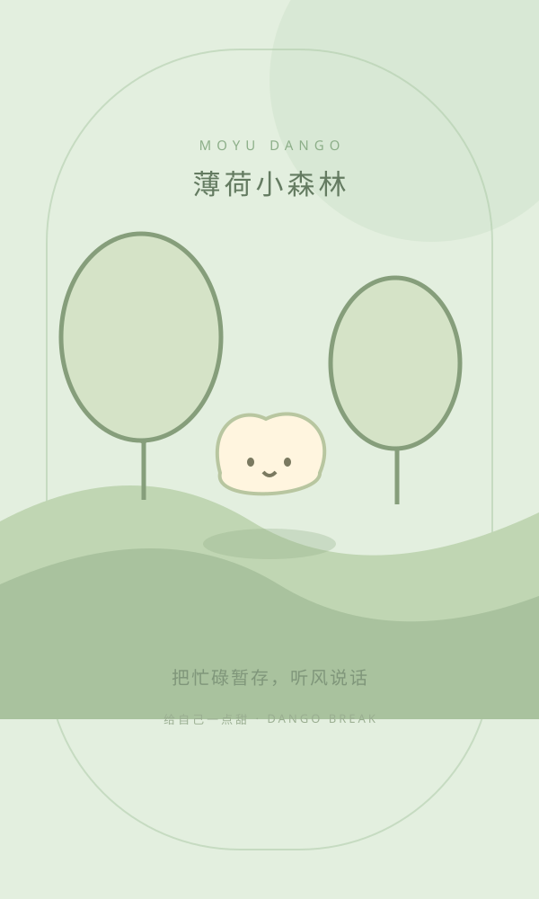
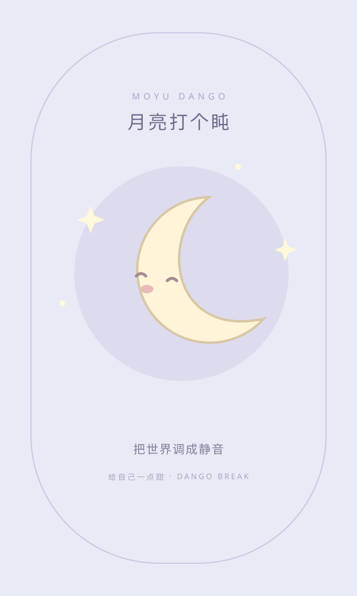
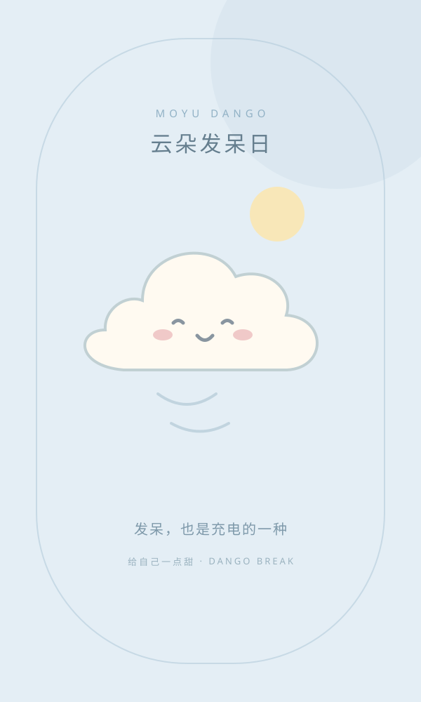

# 摸鱼团子 1.6

[](LICENSE)
[](https://github.com/lovelanshiyi/moyu-dango/actions/workflows/android.yml)

> 一个本机运行的 Android「摸鱼陪伴」小应用：挑一张团子插图进全屏休息，靠光线 / 距离传感器自动把屏幕调暗，
> 双击在原始亮度与全黑之间切换，结束后给你一张统计卡片。**不联网，数据全在本机。**

<p align="center">
  
  
  
  
  
</p>
<p align="center"><sub>内置的 5 张预设插图（矢量图，应用内可替换为自己的照片）</sub></p>

| | |
|---|---|
| 应用名称 | 摸鱼团子 |
| applicationId / namespace | `com.dango.moyu` |
| 版本 | 1.6（versionCode 100007） |
| 运行环境 | Android 6.0+（minSdk 23），targetSdk 34，仅 `arm64-v8a` |
| 作者 | 相安　3199912548@qq.com |
| 许可证 | [MIT](LICENSE) |

---

## 功能

- **5 个预设 + 5 条历史**：每个槽位都能换成自己的照片，支持本机全屏比例拖动 / 缩放 / 旋转裁剪，原图与裁剪 PNG 分开保存。
- **全屏休息**：长按约 650ms 唤起操作菜单；连续两次返回才退出（间隔可调）。
- **自动调暗**：光线（环境光骤降）与距离（感应区变近）两个通道**独立开关、任一满足即生效**，实际把系统亮度设为 0。
- **双击切换亮度**：读取共享的原生调暗状态，在原亮度与 0 之间双向切换。
- **本机数据**：未声明 `INTERNET` 权限，照片与设置都只存在应用私有目录和 WebView localStorage。

## 下载与安装

- 具备 **arm64-v8a** 的 Android 6.0+ 设备（绝大多数现代手机）。
- 从 [Releases](../../releases) 下载 `app-debug.apk`（或自签名的 release 包）后安装：
  ```bash
  adb install -r app-debug.apk
  ```
- 由于声明了 `MANAGE_EXTERNAL_STORAGE` 与 `WRITE_SETTINGS`，首次使用需在设置页按需逐项授权（见下文「权限」）。

## 自行构建

**环境要求**

| 组件 | 版本 |
|---|---|
| JDK | 17 |
| Android SDK Platform | 34（`platforms;android-34`） |
| Android Build-Tools | 35.0.0（`build-tools;35.0.0`） |
| Gradle | 8.14.2（仓库自带 wrapper，无需预装） |
| Android Gradle Plugin | 8.11.1 |

```bash
git clone <仓库地址> && cd <仓库目录>
./gradlew assembleDebug
# 产物：app/build/outputs/apk/debug/app-debug.apk
adb install -r app/build/outputs/apk/debug/app-debug.apk
```

说明：

- `build-tools 35.0.0` 已在 `app/build.gradle.kts` 中显式指定（`compileSdk 34` 默认要 34.0.0 版 build-tools，很多 SDK 安装里没有）。
- `settings.gradle.kts` 在**非 CI** 环境会优先走阿里云镜像加速，GitHub Actions 等 `CI=true` 的环境自动改用官方仓库。
- 只输出 `arm64-v8a`（`abiFilters`）。若要支持其它 ABI，改 `app/build.gradle.kts` 并自行确认依赖里的原生库覆盖到对应架构。
- 首次构建需下载依赖，约 3–5 分钟；之后增量构建在 10 秒级。

## 使用说明

### 首页与导入

- 5 个内置预设：团子放空中、薄荷小森林、月亮打个盹、奶茶续命中、云朵发呆日。
- 【从相册加入照片】：需**相册全部访问**，优先打开**系统相册应用**的选择界面，不可用时回退系统照片选择器。
- 【从文件管理器选择】：需**所有文件访问**，打开**文件管理器选择界面**，可用系统「文件」或 MT 管理器等浏览文件夹选图。

### 全屏与亮度

- 满足**任一已启用**的遮挡判断后，系统亮度设为 **0**；照片继续显示，不使用黑幕。
- **双击**在原亮度与 0 之间切换；光线和距离检测只负责调暗，不会自动恢复。
- **解除遮挡不自动恢复亮度**：双击后即使遮挡未解除也不会立即反复调暗，两种已启用检测都解除后，才重新接受下一次自动触发。
- 仅全屏前台监听，退出与切后台时恢复原亮度与亮度模式；进程被杀时通过 `SharedPreferences` 记录待恢复状态，下次启动补恢复。
- 全屏不显示右上角三个点按钮，长按约 650ms 打开菜单（可关闭）；长按 / 双击 / 返回均受设置页开关控制，各开关独立生效。

### 已知限制

1. 光线通道只能推断「环境变暗」，**无法定位遮挡位置**，小面积遮盖识别不了；初始环境很暗时不可用。
2. 距离通道受硬件位置与精度限制，部分设备只返回远 / 近。
3. 传感器读数、系统亮度实写与渲染表现需真机验收，模拟器上验证不了。
4. `MANAGE_EXTERNAL_STORAGE` 属敏感权限，**仅适合自用 / 侧载**，上架 Google Play 会被拒。
5. 仅 `arm64-v8a` 一种 ABI，不适用于 32 位或 x86 设备。
6. 卸载应用会清空已导入照片与授权状态；旧版本曾被压缩保存过的照片无法恢复画质，需重新导入。

## 权限

设置页【权限与关于】区内每项都有**自己的按钮**，点一个只打开对应入口，互不串联：

| 入口 | 用途 | 判断依据 |
|---|---|---|
| 系统亮度 | 打开「允许修改系统设置」页面 | `Settings.System.canWrite()` |
| 相册全部照片访问 | Android 13+ 申请 `READ_MEDIA_IMAGES`；Android 14 选「仅选中照片」为部分授权 | `checkSelfPermission` |
| 所有文件访问 | 打开「允许管理所有文件」页面（`MANAGE_EXTERNAL_STORAGE`） | `Environment.isExternalStorageManager()`（反射） |
| 文件管理器选择 | 打开系统文件选择器，MT 管理器等兼容应用可自行出现 | `ACTION_GET_CONTENT` |

清单中声明的权限（`app/src/main/AndroidManifest.xml`）：

```
android.permission.WRITE_SETTINGS
android.permission.MANAGE_EXTERNAL_STORAGE
android.permission.READ_MEDIA_IMAGES
android.permission.READ_MEDIA_VISUAL_USER_SELECTED
android.permission.READ_EXTERNAL_STORAGE   (maxSdkVersion=32)
```

**没有** `INTERNET` 权限，也不使用任何网络库；WebView 只加载本地 `file:///android_asset/index.htm`。
光线 / 距离传感器无需 `BODY_SENSORS`；硬件不可用时设置页会直接显示不可用，授权也补不回来。

## 数据存储

- 原生侧照片：应用私有目录 `files/dango_photos/*.txt`（base64 dataURL），删除预设 / 历史时经 `prunePhotos()` 清理。
- 状态（预设、历史、设置、统计）：WebView localStorage，键名 `moyu_dango_state_v1`。
- 无原生桥时降级：照片走 IndexedDB（库名 `moyu_dango_photos`）→ 再退 localStorage（键 `dango_photo_<id>`）。

## 项目结构

```
.
├── build.gradle.kts / settings.gradle.kts / gradle.properties
├── gradlew / gradlew.bat / gradle/wrapper/     # Gradle wrapper（8.14.2）
├── LICENSE / CHANGELOG.md / README.md
├── .gitattributes / .gitignore
├── .github/workflows/android.yml               # CI：push/PR 自动 assembleDebug
└── app/
    ├── build.gradle.kts        # namespace / 版本号 / SDK / ABI / 依赖
    └── src/main/
        ├── AndroidManifest.xml
        ├── assets/             # 网页资源（打包进 APK）
        │   ├── index.htm
        │   └── res/{css,img,js}/
        ├── java/com/dango/
        │   ├── app/MainActivity.java   # WebView 宿主 + DangoNative 桥接
        │   ├── BreakController.java    # 亮度接管、传感器注册、照片存储
        │   ├── CoverDetector.java      # 光线 / 距离遮挡判定
        │   ├── AlbumAccess.java        # 相册权限
        │   └── StorageAccess.java      # 所有文件访问权限
        └── res/                # 图标、主题、应用名
```

## 技术实现

### 亮度的两个通道

`CoverDetector`（判定）+ `BreakController`（执行）：

- 光线通道：环境基线 + 骤降门槛 + 确认时间（150 / 350 / 600 / 1000ms），灵敏度三档。
- 距离通道：阈值 1 / 3 / 5cm，带短时确认。
- 两通道**任一满足即调暗**，恢复后需先解除已启用的遮挡才接受下一次自动触发。
- 光线传感器可能只在值变化时上报，代码用轮询补齐校准与确认时间。

### 原生桥接接口

JS 调原生统一走 `window.DangoNative`（`MainActivity` 通过 `addJavascriptInterface` 注册）：

```
dangoReady, appVersion, canChangeBrightness, permissionInfo, hasPhotoPicker, hasFullAlbumAccess,
albumAccess, requestAlbumAccess, openAlbumSettings, storageGranted, storageAccess,
requestStorageAccess, hasFileManagerPicker, setPickerMode, requestBrightnessAccess,
hasProximity, sensorActive, hasLight, brightnessState, detectionInfo, setDetectionOptions,
screenInfo, prunePhotos, beginBreak, setDim, toggleBrightness, pauseBreak, resumeBreak, endBreak,
setKeepAwake, dangoHaptic, savePhoto, loadPhoto, deletePhoto
```

原生回调 JS（`window.DangoApp`）：

```
nativePaused, nativeResumed, nativeBrightness, nativeCover, nativeBack, permissionsChanged,
openPicker, albumAccessRequired, storageAccessRequired, albumAccessChanged, restoreBrightness,
toggleDim, showControls, begin, finish, isRunning, hasNative
```

### 设置项

设置页分组 01–04，可调项与默认值（取自 `core.js` 的 `defaults()` / `normalize()`）：

| 键 | 说明 | 默认 |
|---|---|---|
| `fit` | 显示方式：铺满 `cover` / 完整 `contain` | `cover` |
| `timerEnabled` / `timer` | 计时开关、时长（分钟，0/5/10/15/25/30） | 开 / 0 |
| `haptic` | 触感反馈 | 开 |
| `keepAwake` | 保持唤醒 | 开 |
| `lightCover` | 光线遮挡开关 | 开 |
| `lightSensitivity` | 光线灵敏度 0/1/2（稳妥 / 标准 / 敏感） | 1 |
| `coverDelay` | 遮挡确认时间（150/350/600/1000ms） | 350 |
| `proximity` | 距离遮挡开关 | 开 |
| `proximityDistance` | 距离阈值（1/3/5cm） | 5 |
| `doubleTapToggle` | 双击切换亮度 | 开 |
| `longPressMenu` | 长按菜单 | 开 |
| `confirmBack` / `backWindow` | 双返回防误退、确认间隔（1000/2000/3000ms） | 开 / 2000 |
| `showHints` | 全屏提示 | 开 |
| `welcome` | 启动开发者介绍 | 开 |
| `recordHistory` | 记录最近历史 | 开 |
| `showSummary` | 结束统计卡片 | 开 |

### 开发提示

- 只改 WebView 资源也必须重新构建安装，`assets/` 不是热更新。
- 日志：`adb logcat -s Dango:*`；网页侧报错经 `WebChromeClient.onConsoleMessage` 打到 logcat，页面加载完成会打印 `Dango: Home page loaded: ...`。
- 验证版本：打开 App → 设置页拉到最底部，`vX.X` 读的是**已安装 APK 的真实版本名**（`PackageManager`）。

## 贡献

欢迎提 Issue 与 PR。动手前请先跑通 `./gradlew assembleDebug`，改动尽量小而聚焦；
涉及传感器 / 亮度实写的行为变更，请在真机上验证并说明测试机型与系统版本。

## 许可证

[MIT](LICENSE) © 2026 相安

版本变更记录见 [CHANGELOG.md](CHANGELOG.md)。
